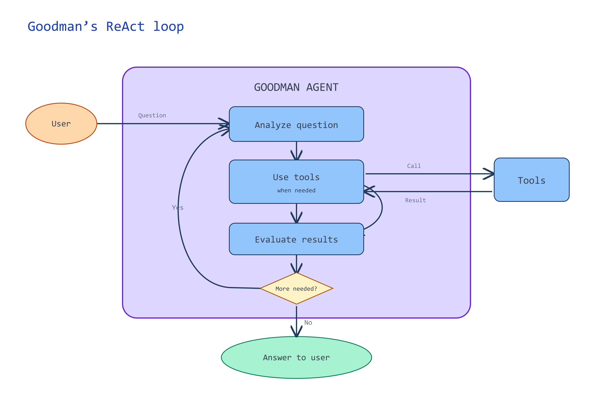

# Better Call Goodman


Goodman is an AI assistant for exploring Nicaraguan law. It combines legal retrieval with a ReAct agent that can investigate a question, use tools, and cite sources when available.

Version: 0.5

## Retrieval-augmented generation (RAG)

Goodman searches a PostgreSQL corpus of Digesto legal instruments and articles. Explicit citations use an instrument and article lookup; topical queries combine article text, instrument titles, and vector similarity. If query embeddings are unavailable, text search remains available. [View the diagram](docs/goodman-retrieval-flow.png)


## ReAct loop

The agent analyzes each question, selects tools when needed, evaluates their results, and repeats until it can answer. Conversation context is passed between turns.



## Tools

Goodman can retrieve legal articles, check a Digesto instrument's registry classification, search and fetch web pages, perform arithmetic, and request a separate relevance check on a response.

## Data pipeline

The initial pipeline collects Digesto records, checks their quality, embeds accepted articles, and loads them into PostgreSQL with pgvector. [View the initial pipeline diagram](docs/initial-pipeline.png).

## Get started

You need Python 3.10+, Docker, and an OpenAI API key. From the project root:

```bash
python -m venv .venv
# Activate the virtual environment, then:
pip install -r requirements.txt
pip install pydantic-ai ddgs
```

Copy `.env.example` to `.env` and set `OPENAI_API_KEY`. Start PostgreSQL and run the initial load:

```bash
docker compose up -d
python -c "from pipelines.initial.main import execute; execute()"
```

The initial load requires empty tables and may take time and incur embedding API costs. To limit new text fetches while still collecting the full catalog, append `--limit 25` to the load command.

Start the agent and enter a question. Type `exit` or `quit` to leave.

```bash
python -m agents.goodman
```

The agent requires access to the configured `openai:gpt-6-luna` model. Its initial load is a separate step and does not run automatically when the agent starts.
