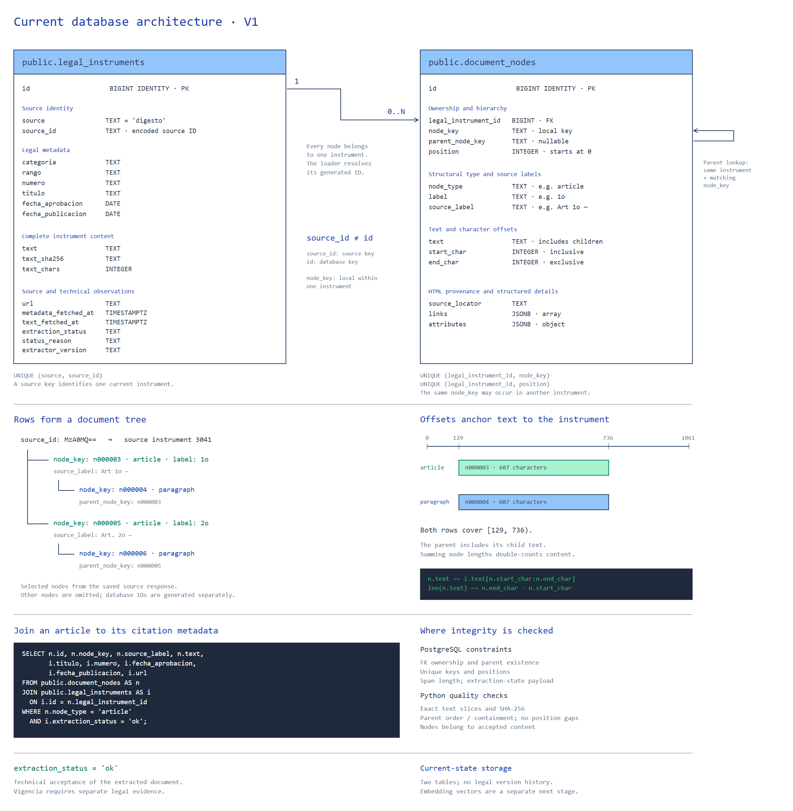

# Current database architecture



[Editable Excalidraw](current-database.excalidraw) · [SVG](current-database.svg) · [PNG](current-database.png)

Read the diagram from the two table definitions, through the example tree and character spans, to the SQL join and integrity checks. It documents the schema and parser in this repository; it does not claim that a live database has been populated.

`legal_instruments` stores one current instrument per `(source, source_id)`. `document_nodes` stores its structural elements. The instrument can have zero nodes when text has not been accepted; the Python quality checks require at least one node for accepted (`ok`) content.

`PK` means primary key. `FK` means foreign key. PostgreSQL generates the numeric `id` values. Source IDs such as `MzA0MQ==` stay separate from those IDs. The source parser's node `id` becomes `node_key` during transformation; its `parent_id` becomes `parent_node_key`.

The parent foreign key matches both `legal_instrument_id` and `parent_node_key` to the same instrument's `node_key`. A null parent marks a root node. Where headings exist, articles can have heading ancestors; heading ancestry is represented by these same parent links. The concrete source example shown has no heading nodes, so the diagram does not invent a chapter for it.

`label` is the parser-recognized identifier; `source_label` retains source wording. Neither a structural label nor `extraction_status = 'ok'` establishes legal force. Approval and publication dates are retained as separate metadata; there is no entry-into-force date in this schema.

The tree and range bars use actual values from `output/node_example_3041/document.json`. The selected article `n000003` and its child paragraph `n000004` both span `[129, 736)` and contain exactly the same 607 characters. This is a saved historical-source example used to explain structure, not evidence of current applicability. Other nodes are omitted. No database-generated IDs are fabricated.

Character spans are zero-based and exclude the ending position. In the diagram's Python expressions, `n` means a node and `i` its instrument. PostgreSQL checks span length; the Python quality report additionally compares exact node text with the instrument slice and verifies hashes and tree ordering. The initial runner blocks loading when that report fails or is incomplete. Direct loader calls bypass the report gate.

The SQL example retrieves technically accepted articles and their instrument metadata. It performs an ordinary relational join, with no vector search. Embeddings, a retrieval chunk table, legal relationships, and legal version history are not implemented in this schema.

The preview is rendered offline from the editable elements. The repository renderer uses installed headless Chrome, a temporary profile, and local SVG, with no remote Excalidraw dependency. To regenerate it from the project root:

```powershell
node docs/render-excalidraw-offline.cjs docs/current-database.excalidraw
```

Sources: `database/schema.sql`, `pipelines/initial/transform.py`, `pipelines/initial/digesto_document.py`, `pipelines/initial/quality.py`, `pipelines/initial/main.py`, and `output/node_example_3041/document.json`.
