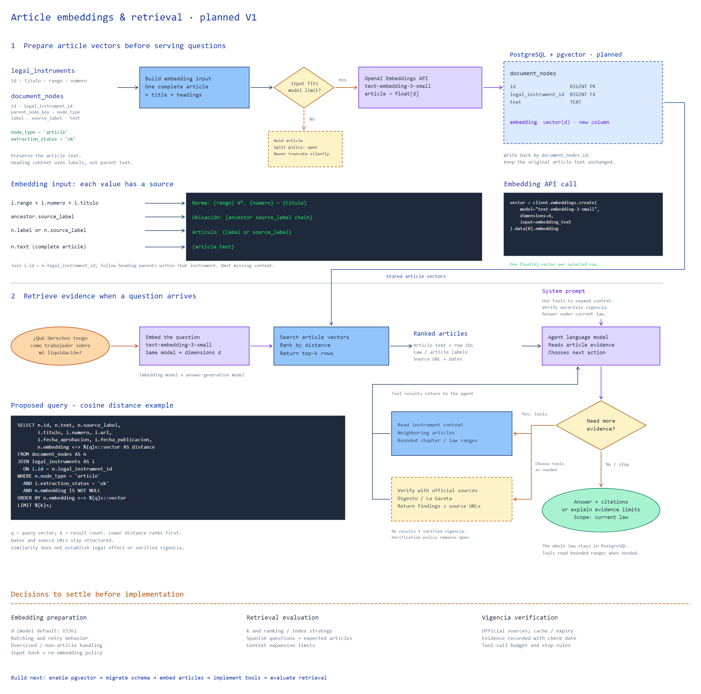

# Article embeddings and retrieval



[Editable Excalidraw](embedding-retrieval.excalidraw) · [SVG](embedding-retrieval.svg) · [PNG](embedding-retrieval.png)

This is the planned V1 architecture. The two input tables and initial ETL exist in the repository. The embedding column, pgvector setup, embedding preparation, retrieval queries, context tools, and legal-agent orchestration shown here are not implemented. No embedding API requests, migrations, or database writes were performed to create this diagram. It complements the [current database diagram](current-database.md) and the [initial pipeline diagram](initial-pipeline.md).

Read the upper path as preparation performed before questions arrive, and the lower path as work performed for an individual question. Purple identifies model operations. Dashed blue marks the planned vector storage change; dashed amber identifies an unresolved handling or verification policy.

## Preparing the vectors

Select complete article nodes belonging to technically accepted instruments: `n.node_type = 'article'` and `i.extraction_status = 'ok'`. Join the instrument through `n.legal_instrument_id = i.id`. Keep paragraphs and other structural nodes for navigation and context; embedding every overlapping parent and child is not the agreed baseline.

Build one embedding input from the instrument's designation and title, heading ancestors' labels in document hierarchy order, the article's label with a source-label fallback, and the exact article text. Here `i` represents a `legal_instruments` row and `n` a `document_nodes` row. An ancestor is found by following `parent_node_key` to `node_key` within the same instrument and selecting heading ancestors. Missing optional context is omitted; no chapter or article number is invented. Parent `text` is not a heading caption because it can include descendants.

The input panel is a template, not fabricated legal content. Instrument dates, source URLs, and identifiers remain structured metadata. Adding context to the embedding input does not modify the stored article text.

Count tokens for the entire constructed input. OpenAI documents an 8,192-token maximum for this model and a default output of 1,536 dimensions. The diagram leaves the chosen dimension count as `d`; a supported numeric value must be selected before schema migration and supplied consistently on both document and query paths. The API snippet illustrates one input and one returned vector. It is not an executable project stage. [OpenAI embedding guide](https://developers.openai.com/api/docs/guides/embeddings), [model documentation](https://developers.openai.com/api/docs/models/text-embedding-3-small).

`vector(d)` is a diagram notation for a dimension-constrained column, not literal migration SQL with an unresolved variable. Install/enable pgvector and add the column before writing vectors. The current Compose image is plain `postgres:16`, and the existing schema has no vector column. Keep the two-table design initially and attach the vector using `document_nodes.id`; unselected rows can have no embedding. Oversized articles and instruments without recognizable article nodes need explicit policies before corpus-wide vectorization. The diagram's hold branch marks that decision; it is not existing pipeline behavior.

Because the embedding represents the full constructed input, changes to titles or heading context can require re-embedding even if article text stays unchanged. The input fingerprint, model configuration tracking, retry behavior, and refresh policy remain to be designed; no new tracking tables or fields are implied.

## Answering a question

Embed the Spanish question using the same model and dimension configuration. Compare that query vector with stored article vectors, retrieve a bounded number of candidates, and pass their text and citation metadata to the agent. The embedding model produces vectors; the agent's language model interprets the retrieved evidence and chooses actions. Its model selection is separate.

The SQL panel is a proposed cosine-distance example, not a deployed query or a finalized ranking decision. In pgvector, `<=>` denotes cosine distance; ascending order returns the closest candidates first. `q` is the query vector supplied as a compatible vector value or representation, and `k` is a positive result count. These are bound parameters. The query becomes usable only after pgvector and the embedding column exist. Exact versus approximate indexing, ranking choices, and `k` remain open. [pgvector querying documentation](https://github.com/pgvector/pgvector#querying).

The agent can fetch neighboring provisions or bounded ranges of an instrument through context tools. The entire law is stored in PostgreSQL, and the system prompt gives instructions for accessing it; the prompt does not contain every law. Retrieved material and source citations provide evidence for the answer.

When relevant evidence is missing or legal status is uncertain, targeted checks against official sources can return findings and source URLs to the agent. The diagram shows the desired tool capability, not a completed verification mechanism. Source selection, cached verification results, expiry, and persistence of supporting evidence remain open. An empty search result is not confirmation of vigencia.

The decision loop ends when enough evidence is available or bounded checking must stop. A stop with unresolved uncertainty leads to an explanation of limits, not an unsupported legal conclusion. Tool budgets and exact stopping rules still require implementation decisions. V1 addresses current law; historical applicability requires external research and cannot be reconstructed from approval-date filtering alone.

## Studying and implementing the design

Start by tracing one article from its source columns to its embedding input, then trace one question to ranked article rows and an answer with citations. Check which identifiers remain attached when the agent requests more context.

The immediate decisions are token-length profiling, dimensions, oversized and non-article coverage, input fingerprints, and retrieval evaluation. Evaluate realistic Spanish questions against expected supporting articles before choosing retrieval settings or adding indexing complexity. The open-decision area also records the unresolved vigencia policy.

To regenerate the preview from the project root:

```powershell
node docs/render-excalidraw-offline.cjs docs/embedding-retrieval.excalidraw
```

Repository evidence: `database/schema.sql`, `docker-compose.yaml`, `pipelines/initial/transform.py`, `pipelines/initial/digesto_document.py`, and `pipelines/initial/main.py`. The diagram's API and SQL panels are illustrative future implementations grounded in the linked primary documentation.
