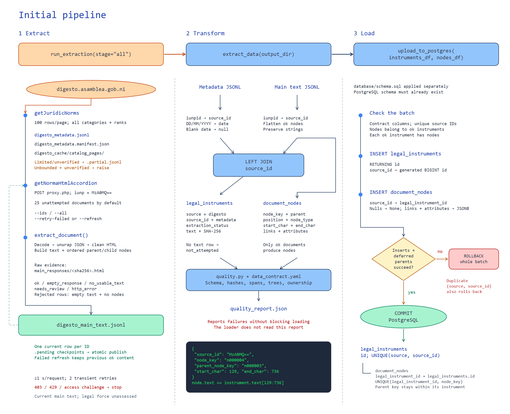

# Initial pipeline



[Editable Excalidraw](initial-pipeline.excalidraw) · [SVG](initial-pipeline.svg)

`run_initial_pipeline()` in `pipelines/initial/main.py` chains extraction, transformation, quality checks, schema setup, article embeddings, and PostgreSQL loading. The diagram above predates the embedding stage. From the project root, install the pipeline dependencies, set `OPENAI_API_KEY` in `.env` (see `.env.example`), and start PostgreSQL:

```powershell
python -m pip install -r requirements.txt
docker compose up -d --wait
python -m pipelines.initial.main
```

This fetches all eligible texts and calls the OpenAI embedding API for accepted articles. For a smaller first run, use `python -m pipelines.initial.main --limit 25`; the catalog is still collected in full and all catalog rows are loaded, including those whose text has not been attempted. Paths and database credentials come from the root `config.py`. The Compose credentials match the defaults. Importing the runner starts no work.

The runner stops before schema setup, embedding calls, or loading when the quality report is failed, incomplete, or has no recognized status. Warnings permit loading. It uses the exact input paths returned by extraction, including when artifacts are in different directories. Schema setup is repeatable and adds the vector column to an existing V1 schema without replacing data. PostgreSQL must have pgvector installed; Compose uses the [official pgvector image](https://github.com/pgvector/pgvector#docker).

Articles use `text-embedding-3-small` with 1,536 dimensions, matching `VECTOR(1536)`. Each input contains the instrument designation, ancestor heading labels, article label, and complete article text. Calls contain at most 32 articles with at most 8,191 tokens each; the SDK handles transient retries. Oversized inputs are logged by source ID and node key, and stored with a null vector without truncating their text. Non-articles also have null vectors. The first tokenizer use may download its encoding data.

The runner checks that the target tables are empty before requesting embeddings. It holds vectors in 32-bit arrays, matches them by `(source_id, node_key)`, and stages bounded insert batches in a single transaction. If PostgreSQL disconnects before commit, the loader waits up to three minutes for it to return and retries the transaction with the vectors already in memory. A lost response during commit requires checking the target before retrying.

The separate stage functions remain available:

```python
from config import OUTPUT_DIR
from pipelines.initial.extract import run_extraction
from pipelines.initial.transform import extract_data
from pipelines.initial.embedding import embedder
from pipelines.initial.load import initialize_database, upload_to_postgres

# Fetch the catalog and the next 25 unattempted documents.
result = run_extraction(stage="all")

# Read both JSONL snapshots and write quality_report.json.
tables = extract_data(OUTPUT_DIR, metadata_path=result.metadata_path, text_path=result.text_path)

# Review the quality report before choosing to load.
# initialize_database()
# nodes = embedder(tables["legal_instruments"], tables["document_nodes"])
# upload_to_postgres(tables["legal_instruments"], nodes)
```

Default artifacts live under `pipelines/initial/output/`. A limited catalog is published to a separate partial file. `extract_data()` reads configured filenames unless explicit input paths are passed. The initial runner requires a complete, reconciled catalog.

Extraction can resume from cached pages, current text rows, and pending checkpoints. A failed text refresh preserves previous accepted content. Quality measurement functions only report errors; the runner enforces the report status before calling the loader. Calling the loader directly bypasses that gate. The loader checks a subset of the contract and relies on SQL constraints for additional enforcement; it does not enforce every measured rule.

Extraction shares one HTTP session across the catalog and text stages. Up to four text requests can be in flight. Request starts are spaced one second apart by default, including redirects and retries. Use `--delay 0.25` to opt into a faster pace of up to four starts per second. To resume text extraction from the existing catalog and checkpoints, run:

```powershell
python -m pipelines.initial.extract texts --all --delay 0.25
```

For the full pipeline, use `python -m pipelines.initial.main --delay 0.25`. At this pace, 42,447 text requests take at least 2 hours and 57 minutes, before retries and other overhead. A small live sample succeeded at this pace. Digesto publishes no throughput guarantee. HTTP 403, HTTP 429, HTTP 503 with `Retry-After`, or an access challenge stops the run and preserves completed checkpoints.

The database loader is insert-only. A duplicate `(source, source_id)` rolls back the batch. A successful limited run already inserts the full catalog, so it cannot be extended by rerunning this loader. To collect the corpus incrementally before loading, call `run_extraction(stage="all", limit=25)` repeatedly, then run the initial pipeline once. Restarting the Python process regenerates embeddings.

Run the offline tests with `python -m unittest discover -s tests -q`. PostgreSQL integration tests require a disposable pgvector server on `GOODMAN_TEST_POSTGRES_PORT`, with database `goodman_loader_test` and user/password `loader_test`. They use temporary schemas and make no OpenAI requests.

The example node is taken from `output/node_example_3041/document.json`: `n000004` is a paragraph under article `n000003`, spanning characters `[129:736]`. The green data excerpt shows its transformed field names. Extraction status measures technical acceptance, not whether an instrument is legally in force.

Sources: `pipelines/initial/extract.py`, `digesto_document.py`, `transform.py`, `quality.py`, `load.py`, `config.py`, `data_contract.yaml`, and `database/schema.sql`. The diagram documents the code as inspected on November 15, 2026. No extraction or database loading was run to create it.

The PNG and SVG previews use an offline renderer because the standard renderer's remote Excalidraw dependency was unavailable. The `.excalidraw` file retains native editable elements.
